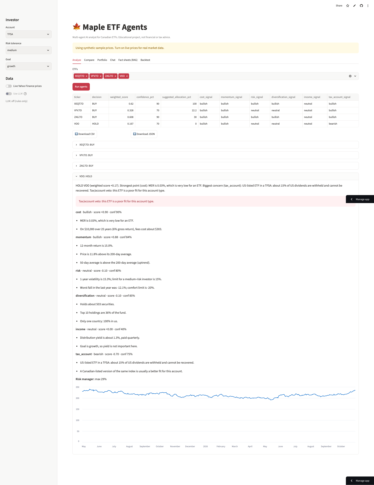
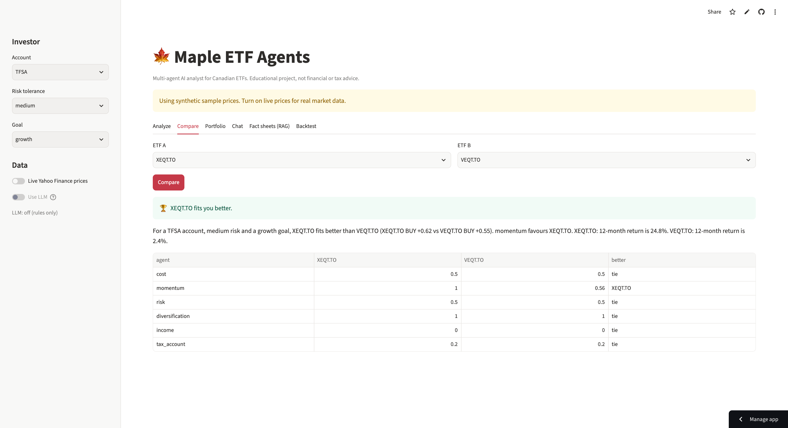
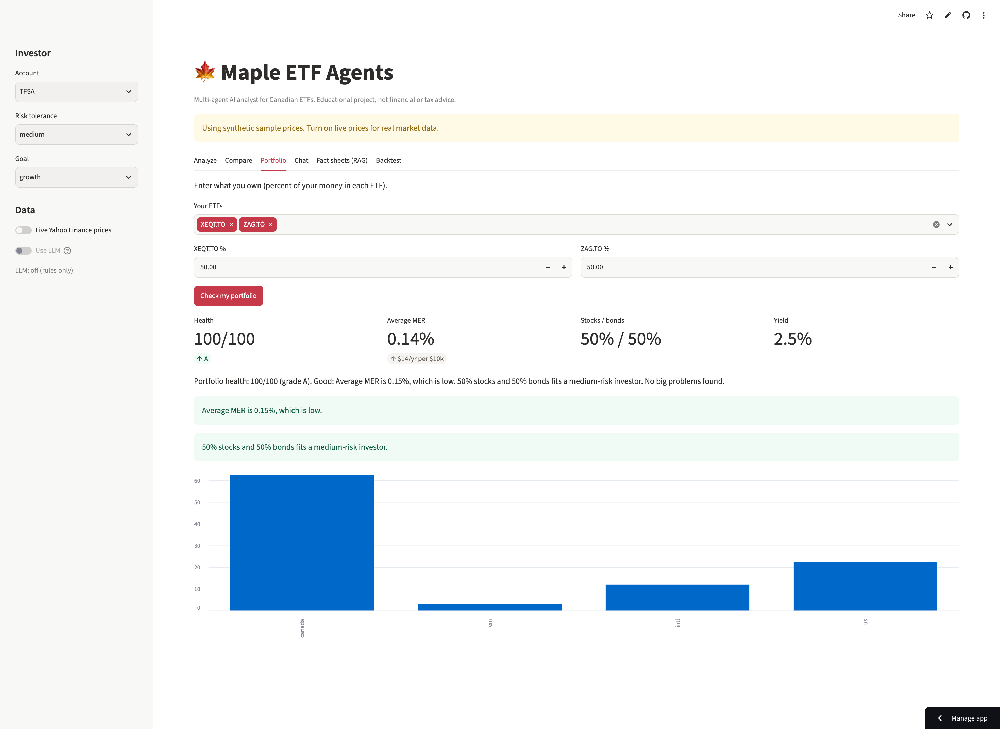
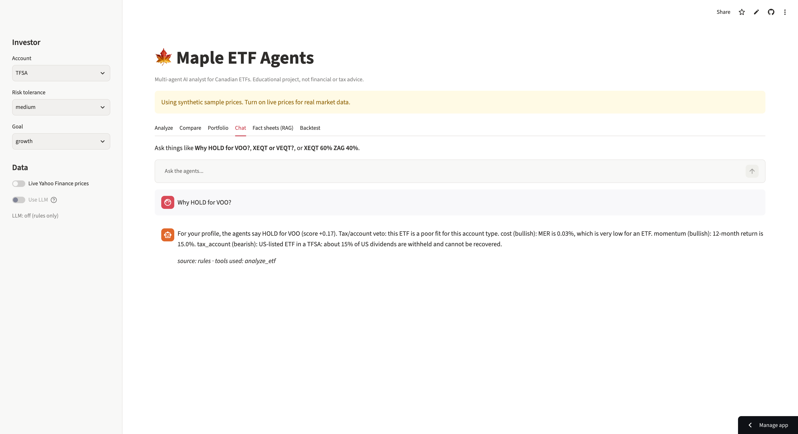
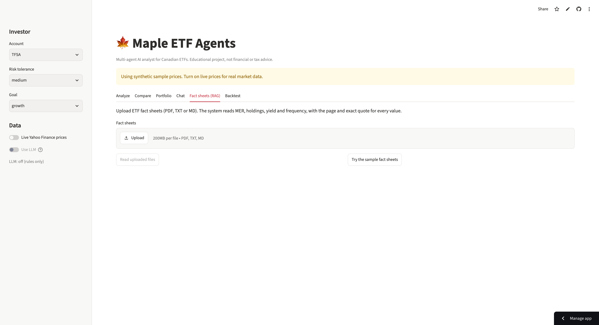
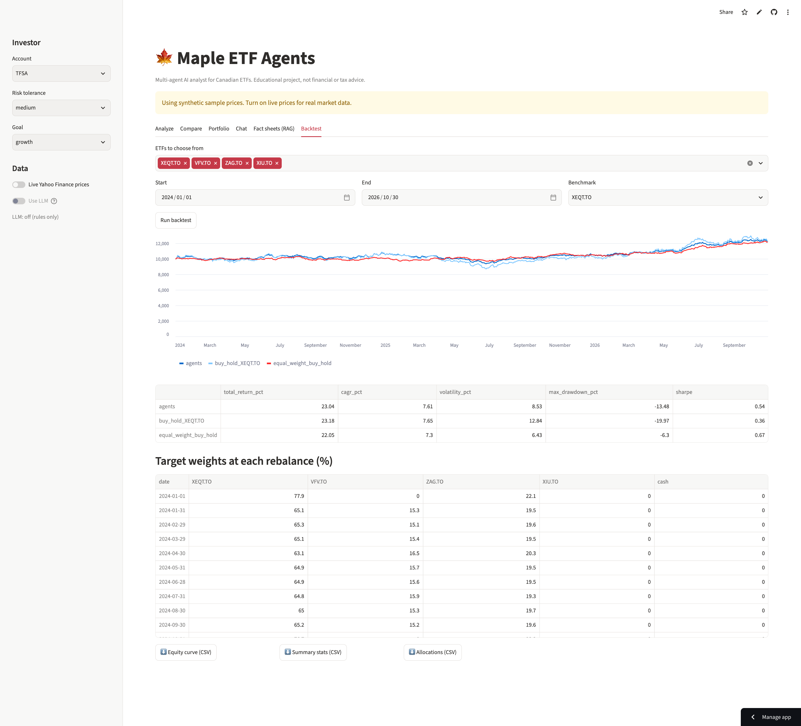
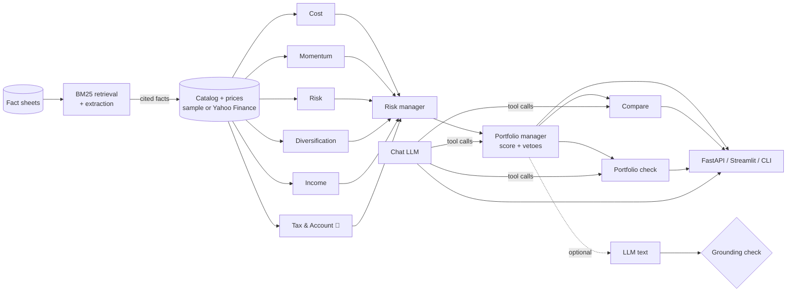

# 🍁 Maple ETF Agents

**A multi-agent AI analyst for Canadian ETFs, with evals, guardrails, RAG, tool-calling chat, an API and a backtester.**

**🚀 Live demo:** https://maple-etf-agents.streamlit.app/

Six analyst agents look at an ETF from different angles: fees, trend, risk, diversification, income, and **Canadian tax and account fit** (TFSA / RRSP / FHSA / non-registered). A risk manager limits position size. A portfolio manager decides **BUY / HOLD / AVOID**. On top of that you can:

- **Compare** two ETFs for *your* situation
- **Check a whole portfolio** (fees, countries, stocks vs bonds, overlap)
- **Chat** with the agents. The LLM calls the agents as tools instead of answering from memory.
- **Read real fact sheets (RAG)** to pull MER, holdings and yield from PDFs, with page and quote citations
- **Grade explanations with an LLM-as-judge**, calibrated against human labels
- **Call everything through a REST API**, packaged with Docker

Every number an LLM writes is **checked with code** against the facts. If the LLM invents a number, its answer is rejected.

> ⚠️ Educational project. Not financial or tax advice.

   

---

## Demo

| Analyze | Compare |
|---|---|
|  |  |
| **Portfolio** | **Chat** |
|  |  |
| **Fact sheets (RAG)** | **Backtest** |
|  |  |

```text
$ python -m maple_etf analyze XEQT.TO VFV.TO VOO ZAG.TO ZEB.TO --account TFSA --brief

ETF      Decision  Score  Conf.  Max alloc.  Agent signals
-------  --------  -----  -----  ----------  -----------------------------------
XEQT.TO  ✅ BUY     +0.62  90%    100%        cost▲ mome▲ risk▲ dive▲ inco● tax_▲
VFV.TO   ✅ BUY     +0.33  70%    22%         cost▲ mome▲ risk● dive● inco● tax_▲
VOO      ⏸  HOLD   +0.17  70%    0%          cost▲ mome▲ risk● dive● inco● tax_▼
ZAG.TO   ✅ BUY     +0.61  90%    30%         cost▲ mome▲ risk▲ dive▲ inco● tax_▲
ZEB.TO   ⛔ AVOID   -0.59  80%    0%          cost▼ mome▼ risk▼ dive▼ inco● tax_▲
```

**VOO** has the lowest fee, but it's US-listed. In a **TFSA**, about 15% of its US dividends are withheld and can't be recovered, so the tax agent vetoes the BUY. Run the same command with `--account RRSP`, where the Canada-US tax treaty usually removes that withholding, and VOO becomes a BUY.

```text
$ python -m maple_etf portfolio XEQT.TO=60 ZAG.TO=40

Average MER 0.16% (about $16/year per $10,000) | stocks 60% / bonds 40% | yield 2.4%
Health score: 100/100 (grade A)
  ✅ Average MER is 0.16%, which is low.
  ✅ Your money is spread across several parts of the world.
  ✅ 60% stocks and 40% bonds fits a medium-risk investor.
```

## Architecture



- The analysts run **in parallel** and are **deterministic**, so the same input always gives the same output. That's what makes them testable.
- The orchestrator is plain Python (`graph.py`), with no framework lock-in.
- Each run is logged to `traces/runs.jsonl`: every step, its timing, its signal, and LLM tokens.

## Features

### 1. Six analyst agents + risk manager + portfolio manager

| Agent | Looks at | Example reason |
|---|---|---|
| **Cost** | MER, 25-year fee drag, currency hedging | "On $10,000 over 25 years, fees cost about $1,979." |
| **Momentum** | 12-month return, 50/200-day averages | "Price is 6.1% above its 200-day average." |
| **Risk** | Volatility and drawdown vs *your* tolerance | "1-year volatility is 12.9%; limit for a medium-risk investor is 15%." |
| **Diversification** | Holdings, top-10 weight, countries | "Spread across 4 regions (largest: us at 45%)." |
| **Income** | Yield vs *your* goal, covered-call warning | "Covered-call ETF: the price has less room to grow." |
| **🍁 Tax & Account** | ETF structure × account type | "US-listed ETF in a TFSA: about 15% of US dividends are withheld." |

17 ETFs are in `maple_etf/data/catalog.json`: XEQT, VEQT, XGRO, VBAL, VFV, ZSP, XSP (CAD-hedged), VOO, XAW, XEF, XIU, VCN, VDY, ZEB, ZWC (covered call), ZAG and XBB.

### 2. ETF Comparison Agent
```bash
python -m maple_etf compare VOO ZSP.TO --account TFSA
```
It runs the full team on both ETFs, compares them agent by agent, and explains the biggest differences. An ETF with a veto loses to one without, and near-identical ETFs (like ZAG vs XBB) are called a **tie**.

### 3. Portfolio mode
```bash
python -m maple_etf portfolio VFV.TO=40 ZSP.TO=30 VOO=20 ZEB.TO=10 --risk low
```
It "looks through" each ETF to check average fees, country concentration, stocks vs bonds against your risk level, combined volatility, tax problems, and **overlap**: "VFV.TO and VOO and ZSP.TO hold almost the same thing". The result is a health score from 0 to 100 and a grade.

### 4. Chat with tool calling
```bash
python -m maple_etf chat
You: Why did you say HOLD for VOO?
```
The LLM gets 5 tools (`list_etfs`, `get_etf_facts`, `analyze_etf`, `compare_etfs`, `check_portfolio`). It chooses which ones to call, reads their JSON results, and answers. It works with **both** the OpenAI-style and the Anthropic-style tool formats.
- Numbers in the answer that aren't in the tool results → the answer is rejected, and the rules-based answer is shown instead.
- No LLM configured, or the LLM is down → a rules-based router still answers, so the free live demo works with no API key.

### 5. RAG on ETF fact sheets
```bash
python -m maple_etf rag extract my_fact_sheets/ --ticker XEQT.TO          # read facts, compare with catalog
python -m maple_etf rag extract xeqt.pdf --ticker XEQT.TO --apply         # update catalog.json
python -m maple_etf rag ask my_fact_sheets/ "What is the MER of XBB?"     # answer with [1] citations
```
The pipeline is load PDF/TXT/MD → chunk → **BM25 retrieval** (no embedding model or API needed) → extract MER, holdings, yield and frequency. **Regex runs first.** When regex fails, the **LLM** must return the value *and an exact quote*. The code checks that the quote really is in the document and that the value is in the quote. Every accepted value keeps a citation (file, page and quote).

### 6. LLM-as-judge, calibrated
```bash
python -m maple_etf judge eval      # how well do the judges agree with human grades?
python -m maple_etf judge label     # add your own grades in the terminal
```
Each explanation is graded **correct / clear / simple**. A free heuristic judge and an LLM judge are both compared with human labels in `evals/judge_labels.json`, using agreement % and **Cohen's kappa**.

### 7. REST API + Docker
```bash
pip install -r requirements-api.txt
uvicorn maple_etf.api:app --reload        # http://localhost:8000/docs
docker compose up --build                 # API on :8000 and web app on :8501
```
| Method | Endpoint | Body example |
|---|---|---|
| GET | `/health`, `/etfs` | |
| POST | `/analyze` | `{"tickers": ["XEQT.TO", "VOO"], "account": "TFSA"}` |
| POST | `/compare` | `{"a": "VOO", "b": "ZSP.TO", "account": "RRSP"}` |
| POST | `/portfolio` | `{"holdings": {"XEQT.TO": 60, "ZAG.TO": 40}}` |
| POST | `/chat` | `{"question": "Why HOLD for VOO?"}` |

### 8. Downloads, backtester, web app
The web app has **CSV/JSON downloads**. The CLI has `--csv`. The monthly backtester has no look-ahead and compares against buy-and-hold. The web app has 6 tabs: Analyze, Compare, Portfolio, Chat, Fact sheets, Backtest.

## Evals

| Eval | Command | Result |
|---|---|---|
| Golden scenarios: agent signals | `python -m maple_etf eval` | **100%** (52 checks, 34 cases) |
| Golden scenarios: BUY/HOLD/AVOID | ↑ | **100%** (18 checks) |
| Comparison winners | ↑ | **100%** (6 pairs) |
| Explanation groundedness | ↑ | **100%** |
| RAG extraction (sample fact sheets, regex only) | `python -m maple_etf rag eval` | **92%** (11/12) |
| RAG retrieval (right document ranked first) | ↑ | **100%** (4/4) |
| Heuristic judge vs human labels | `python -m maple_etf judge eval` | correct 93% (κ 0.82), clear 80% (κ 0.29), simple 100% |

All of these run in **GitHub Actions** on every push, together with 79 tests and a Docker build that checks `/health`.

### What the evals found (and what I fixed)

1. **Risk agent too strict.** A 60/40 fund *inside* both risk limits was rated neutral. I fixed the scoring and the case now passes.
2. **Misleading reason.** XEF holds 2,500 stocks in many countries, but the reason said "only one region". I fixed it and added a test.
3. **Comparison ignored vetoes.** VOO vs ZSP in a TFSA came out a "tie" even though VOO had a tax veto. Vetoes now decide first.
4. **Regex can't read tables.** The RAG eval misses one yield written as `Yield (%) 5.10` in a table. This is where the LLM extractor helps, and its quote check stops made-up values (tested).
5. **Heuristic judge has blind spots.** It can't see a wrong claim that has no numbers ("VDY is a bond fund"), and its kappa on "clear" is only 0.29. That's the reason for an LLM judge, and for checking it against human labels before trusting it.
6. **Confusing AVOID text.** Human labeling showed that an AVOID explanation starting with "Strongest point" was unclear. The template now leads with the main reason.

## Guardrails

1. **Grounding check:** every number an LLM writes must match the facts at the precision written. "24.8%" for 24.83 passes, "0.15%" for 0.20 fails.
2. **Citation check (RAG):** the extracted value must be inside an exact quote from the cited chunk.
3. **Hard vetoes:** a tax or risk problem turns BUY into HOLD, even when the LLM is deciding.
4. **Fallbacks everywhere:** network errors, bad JSON or an unknown tool fall back to the rules. The app never breaks because of the LLM.
5. **No look-ahead** in backtests.

## Quick start

```bash
git clone https://github.com/shivani-swe-ll/maple-etf-agents.git
cd maple-etf-agents
python3 -m venv .venv && source .venv/bin/activate
pip install -r requirements.txt

python -m maple_etf list
python -m maple_etf analyze XEQT.TO VOO --account TFSA
python -m maple_etf compare XEQT.TO VEQT.TO
python -m maple_etf portfolio XEQT.TO=60 ZAG.TO=40
python -m maple_etf chat
python -m maple_etf rag extract evals/rag_samples
python -m maple_etf eval
streamlit run app/streamlit_app.py
pytest -q
```

Add `--live` to most commands for real Yahoo Finance prices. Common options: `--account TFSA|RRSP|FHSA|NON_REGISTERED`, `--risk low|medium|high`, `--goal growth|income|balanced`.

### Use an LLM (optional, and free with Ollama)

Copy `.env.example` to `.env` and choose **Ollama** (free, runs on your computer), a free API tier, Anthropic, or any OpenAI-compatible API. The client uses only the Python standard library. On Streamlit Cloud, put the same values in **Settings → Secrets** instead of `.env`.

## Project structure

```text
maple_etf/
  agents/           6 analysts, risk manager, portfolio manager
  data/             catalog.json (17 ETFs), price providers (sample + Yahoo Finance)
  rag/              documents + BM25, fact extraction with citations, Q&A, RAG eval
  graph.py          orchestrator: parallel analysts -> risk manager -> PM, JSONL traces
  compare.py        ETF Comparison Agent
  portfolio.py      portfolio mode (look-through checks, health score)
  chat.py           tool-calling chat + rules fallback
  judge.py          LLM-as-judge, heuristic judge, calibration (kappa)
  explain.py        shared "LLM text + grounding check" helper
  grounding.py      number checking
  llm.py            Anthropic / OpenAI-compatible client with tool calling (stdlib only)
  service.py        one service layer for API + tests
  api.py            FastAPI app
  evals.py          golden-set eval harness
  backtest.py       monthly backtester
  cli.py            command line
app/streamlit_app.py  web app (6 tabs)
evals/              golden_cases.json, judge_labels.json, rag_samples/, results/
tests/              79 tests (fake LLM servers, no internet needed)
Dockerfile, docker-compose.yml, .github/workflows/ci.yml
```

## Limitations

- ETF facts in `catalog.json` are **approximate**. Check them on the issuer's website, or update them from real fact sheets with `rag extract --apply`.
- Without `--live`, prices are **synthetic**. They're good for demos and reproducible evals, but they mean nothing for real performance.
- The tax rules are simplified rules of thumb.
- The sample fact sheets in `evals/rag_samples` are **made up** for testing. Real PDFs vary more.
- The golden set and the starter judge labels were written by one person. More cases and more reviewers would make them stronger.


## License

MIT © 2026 Shivani Anghan
