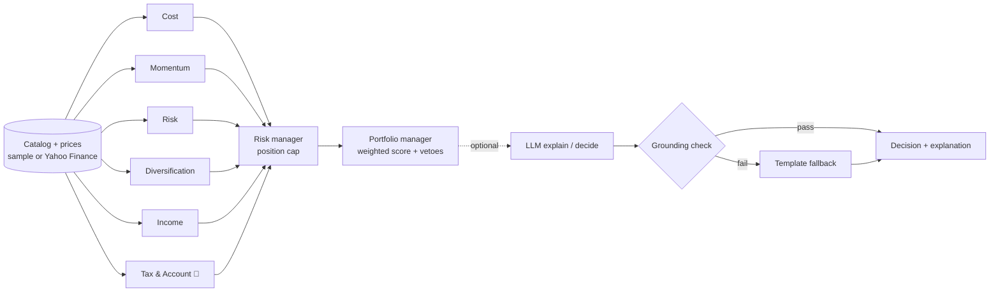

# 🍁 Maple ETF Agents

**A multi-agent AI analyst for Canadian ETFs, with evals, guardrails and a backtester.**

Six analyst agents look at an ETF from different angles: fees, trend, risk, diversification, income, and **Canadian tax and account fit** (TFSA / RRSP / FHSA / non-registered). A risk manager sets a position limit. A portfolio manager combines the signals into **BUY / HOLD / AVOID**, and an optional LLM explains the decision in plain English.

Every number the LLM writes is **checked with code** against the agents' facts. If the LLM invents a number, its answer is rejected. An evaluation suite with 24 golden scenarios measures the system and runs in CI on every push.

> ⚠️ Educational project. Not financial or tax advice.

   

---

## Why this project

Most AI demos only show the happy path. Real AI systems need to be **measured** and **kept safe**. This project focuses on:

- **Multi-agent design:** small, focused agents with structured (Pydantic) outputs
- **Domain knowledge:** the same ETF can be right in an RRSP and wrong in a TFSA
- **Evals:** a golden set, accuracy for each agent, and a list of failures grouped by type
- **Guardrails:** hard vetoes the LLM cannot override, and grounding checks on LLM text
- **Production habits:** JSONL traces, fallbacks when the LLM fails, CI, and tests with no network

## Demo

   

   
   
```text
$ python -m maple_etf analyze XEQT.TO VFV.TO VOO ZAG.TO ZEB.TO --account TFSA --brief

Investor: TFSA account, medium risk, growth goal

ETF      Decision  Score  Conf.  Max alloc.  Agent signals
-------  --------  -----  -----  ----------  -----------------------------------
XEQT.TO  ✅ BUY     +0.62  90%    100%        cost▲ mome▲ risk▲ dive▲ inco● tax_▲
VFV.TO   ✅ BUY     +0.33  70%    22%         cost▲ mome▲ risk● dive● inco● tax_▲
VOO      ⏸  HOLD   +0.17  70%    0%          cost▲ mome▲ risk● dive● inco● tax_▼
ZAG.TO   ✅ BUY     +0.61  90%    30%         cost▲ mome▲ risk▲ dive▲ inco● tax_▲
ZEB.TO   ⛔ AVOID   -0.59  80%    0%          cost▼ mome▼ risk▼ dive▼ inco● tax_▲
```

*(Run with offline synthetic prices. Use `--live` for real market data.)*

Notice **VOO**: it has the lowest fee, but it's US-listed. In a **TFSA**, about 15% of its US dividends are withheld and can't be recovered, so the tax agent vetoes the BUY. Run the same command with `--account RRSP`, where the Canada-US tax treaty usually removes that withholding, and VOO becomes a BUY.

## Architecture



- The analysts run **in parallel** (thread pool) and are **deterministic**, so the same input always gives the same output. That's what makes them testable.
- The orchestrator is plain Python (`maple_etf/graph.py`), with no framework lock-in, so it's easy to read.
- Each run adds one line to `traces/runs.jsonl`: every step, its timing, its signal, LLM tokens, and any rejected numbers.

## The agents

| Agent | Looks at | Example reason |
|---|---|---|
| **Cost** | MER, and fees lost over 25 years | "On $10,000 over 25 years, fees cost about $1,979." |
| **Momentum** | 12-month return, 50/200-day averages | "Price is 6.1% above its 200-day average." |
| **Risk** | Volatility and drawdown vs *your* risk tolerance | "1-year volatility is 12.9%; limit for a medium-risk investor is 15%." |
| **Diversification** | Number of holdings, top-10 weight, regions | "Spread across 4 regions (largest: us at 45%)." |
| **Income** | Yield and frequency vs *your* goal | "Monthly payments suit an income investor." |
| **🍁 Tax & Account** *(new)* | ETF structure × account type | "US-listed ETF in a TFSA: about 15% of US dividends are withheld and cannot be recovered." |
| Risk manager | Max % of the portfolio for one ETF | "Only 6 holdings (concentrated), so capped at 10%." |
| Portfolio manager | Confidence-weighted score, vetoes, final call | `BUY` / `HOLD` / `AVOID` |

**Tax & Account rules** (simplified):

| ETF type | TFSA | RRSP | FHSA | Non-registered |
|---|---|---|---|---|
| US-listed (e.g. VOO) | ▼ withholding lost | ▲ treaty exempt | ▼ withholding lost | ● foreign tax credit |
| Canadian-listed, foreign stocks (XEQT, VFV) | ▲ simple, CAD | ▲ | ● (100% stocks: short horizon) | ▲ |
| Canadian stocks (XIU, VDY) | ▲ | ▲ | ▲ | ▲▲ dividend tax credit |
| Bonds (ZAG) | ▲ sheltered | ▲ sheltered | ▲ | ▼ interest fully taxed |

## Evals

```bash
python -m maple_etf eval
```

`evals/golden_cases.json` holds **24 scenarios**. Each one is an ETF, a price path (trend, volatility, or a crash), an investor, and the answer a careful human analyst would give. The harness measures:

| Metric | Result |
|---|---|
| Agent signal accuracy | **100%** (35 checks) |
| Decision accuracy (BUY/HOLD/AVOID) | **100%** (13 checks) |
| Explanation groundedness | **100%** |

Every failure is tagged by type (`agent_signal_mismatch`, `decision_mismatch`, `ungrounded_explanation`, `llm_rejected_fallback_used`), so you see **what** broke, not just how often. Results are saved to `evals/results/latest.md` and `latest.json`.

**A bug the evals found.** The first run scored 23/24. In the `balanced-low-risk` case, a 60/40 fund *inside* both risk limits (7.2% volatility vs an 8% limit, -8.1% drawdown vs a -10% limit) was rated **neutral** instead of **bullish**. The risk agent gave 0 points for "inside the limit but close to it". I changed it to a small plus, re-ran the evals, and got 24/24 with nothing else broken.

To test the LLM layer too, set up `.env` and run:

```bash
python -m maple_etf eval --with-llm               # LLM writes the explanations
python -m maple_etf eval --with-llm --llm-mode decide   # LLM makes the decision
```

## Guardrails

1. **Grounding check** (`grounding.py`): Every number in the LLM's text must match a number in the facts it was given, at the precision written. "24.8%" for 24.83 passes, "0.15%" for 0.20 fails. If any number fails, the answer is rejected and a template explanation is used.
2. **Hard vetoes:** A strong tax/account or risk problem turns a BUY into a HOLD. Two vetoes force AVOID. This applies **after** the LLM, so the LLM can't override it.
3. **Fallbacks:** If there's a network error, bad JSON, or an unknown action, the system falls back to the rules. The app never crashes because of the LLM.
4. **No look-ahead:** In backtests, the agents only see prices up to each rebalance date.

## Quick start

```bash
git clone https://github.com/shivani-swe-ll/maple-etf-agents.git
cd maple-etf-agents
python -m venv .venv && source .venv/bin/activate    # Windows: .venv\Scripts\activate
pip install -r requirements.txt

python -m maple_etf list                                     # ETFs in the catalog
python -m maple_etf analyze XEQT.TO VOO --account TFSA      # offline, no keys needed
python -m maple_etf analyze XEQT.TO VOO --account RRSP --live   # real prices
python -m maple_etf eval                                     # run the evals
pytest -q                                                    # 35 tests
```

**Options:** `--account TFSA|RRSP|FHSA|NON_REGISTERED`, `--risk low|medium|high`, `--goal growth|income|balanced`, `--live`, `--as-of YYYY-MM-DD`, `--json`, `--brief`, `--llm auto|off|explain|decide`.

### Add an LLM (optional)

Copy `.env.example` to `.env` and choose Anthropic, OpenAI-compatible (OpenAI, Groq…), or a **free local model with Ollama**. The client uses only the Python standard library, so you don't need an SDK.

```bash
python -m maple_etf analyze XEQT.TO VFV.TO --llm explain   # rules decide, LLM explains
python -m maple_etf analyze XEQT.TO VFV.TO --llm decide    # LLM decides (guardrails still apply)
```

### Backtest

```bash
python -m maple_etf backtest XEQT.TO VFV.TO ZAG.TO XIU.TO ZEB.TO --start 2024-01-01 --live --out results/equity.csv
```

This rebalances every month to the agents' BUY list and compares the result with buying and holding a benchmark (default XEQT) and an equal-weight portfolio. It reports total return, CAGR, volatility, max drawdown and Sharpe ratio. A 5 bps trading cost is included.

### Web app

```bash
streamlit run app/streamlit_app.py
```

Pick your account, risk and goal, choose ETFs, then run the agents or a backtest.

## Project structure

```text
maple_etf/
  agents/            cost, momentum, risk, diversification, income, tax_account,
                     risk_manager, portfolio_manager
  data/              catalog.json (ETF facts), price providers (sample + Yahoo Finance)
  graph.py           orchestrator: parallel analysts -> risk manager -> PM, JSONL traces
  llm.py             tiny Anthropic / OpenAI-compatible client (stdlib only)
  grounding.py       checks every LLM number against the facts
  evals.py           golden-set eval harness + failure taxonomy
  backtest.py        monthly backtester, no look-ahead
  metrics.py         returns, volatility, drawdown, Sharpe, fee drag
  cli.py             command line
app/streamlit_app.py web UI
evals/               golden_cases.json, results/
tests/               35 pytest tests (fake LLM + local fake HTTP server, no internet)
.github/workflows/   CI: tests + evals on every push
```

## Limitations

- `data/catalog.json` holds **approximate** ETF facts (MER, holdings, yield, regions). They change over time. Check the issuer's website before you rely on them.
- Without `--live`, prices are **synthetic** (a seeded random walk). They're good for demos and reproducible evals, but they mean nothing for real performance.
- The tax rules are simplified rules of thumb. They don't cover every case (for example, two layers of withholding inside wrap ETFs, or province-specific tax rates).
- The golden set was written by one person. More cases and a second reviewer would make it stronger.
- Momentum and risk only look backward. Past returns don't predict future returns.

## Roadmap

- [ ] Pull MER and holdings automatically from issuer data
- [ ] An LLM-as-judge for explanation quality, calibrated against my own labels
- [ ] More golden cases (currency-hedged ETFs, covered-call ETFs)
- [ ] A FastAPI endpoint and a Docker image

## Credits

The multi-agent "investment committee" idea was inspired by [virattt/ai-hedge-fund](https://github.com/virattt/ai-hedge-fund). This project is a separate implementation that focuses on Canadian ETFs, account-aware tax logic, evals and guardrails.

## License

MIT © 2026 Shivani Anghan
